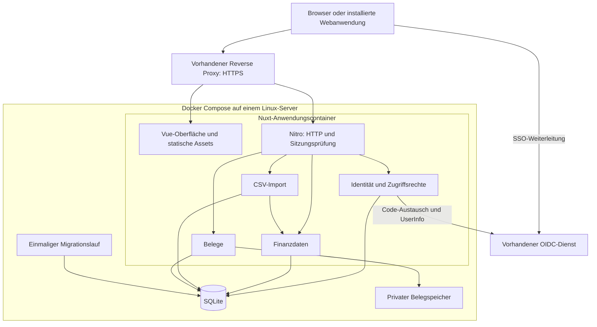

# Referenzarchitektur: WiMM

Stand: 28. Oktober 2026. Status: Zielarchitektur für die erste Umsetzung.

## 1. Ziel und Entscheidungen

WiMM ist eine mobile-first Webanwendung für Einnahmen und Ausgaben. Mehrere Benutzer arbeiten in gemeinsamen, voneinander getrennten Bereichen, beispielsweise Haushalten. Zum ersten Umfang gehören Konten, Kategorien, manuelle Buchungen, einfache Summen und Filter, CSV-Import und Belege.

**Die Zielarchitektur ist eine Nuxt-Fullstack-Anwendung mit SQLite, betrieben als einzelner Anwendungscontainer hinter einem vorhandenen HTTPS-Reverse-Proxy.** Docker Compose installiert und startet die Anwendung einschließlich Datenbankmigrationen. Ein vorhandener OpenID-Connect-Dienst übernimmt die Anmeldung und liefert Gruppen für die Zugriffsrechte.

Dieses Dokument legt die Architektur fest. Die beschriebenen Dateien, Befehle und Endpunkte sind Verträge für die folgende Implementierung; Anwendung, Containerimage, Compose-Datei und Verwaltungsbefehle existieren noch nicht. Der bisherige Repo-Inhalt ist experimentell und begründet keine Architekturentscheidung.

### Annahmen und Grenzen

- Kleiner Benutzerkreis, geringe Schreibkonkurrenz und ein einzelner Linux-Server mit lokalem persistentem Speicher.
- Gemeinsame Bereiche können mehrere Mitglieder haben; ein Benutzer kann mehreren Bereichen angehören.
- Ein Bereich verwendet zunächst EUR. Währungsumrechnung und bereichsübergreifende Summen entfallen.
- Die Anwendung benötigt eine Verbindung zum Server. Eine Installation auf dem Startbildschirm ist eine ergänzende Nutzungsmöglichkeit.
- Doppelte Buchführung, Bankanbindungen, OCR, Offline-Bearbeitung und revisionssichere Archivierung gehören nicht zum ersten Umfang.

## 2. Konkrete Komponenten

| Aufgabe | Entscheidung | Verantwortung |
| --- | --- | --- |
| Framework | Nuxt 4, Vue 3, TypeScript | Oberfläche, Routing, Build und Server in einem Projekt |
| Oberfläche | Nuxt UI und Tailwind CSS | Formulare, Dialoge, Listen, Tabellen und responsive Gestaltung |
| HTTP-Server | Nitro mit Node.js LTS, Preset `node-server` | JSON-Endpunkte, Authentifizierung, statische Assets und Downloads |
| Validierung | Zod | Verbindliche Prüfung von Eingaben und Konfiguration auf dem Server |
| Datenzugriff | Drizzle ORM mit `better-sqlite3` | Typisierte Abfragen und Transaktionen |
| Schemaänderungen | Drizzle Kit, eingecheckte SQL-Migrationen | Nachvollziehbare, versionierte Datenbankentwicklung |
| Datenbank | SQLite | Fachliche Daten, Importvorschauen und serverseitige Sitzungen |
| Anmeldung | Nuxt Auth Utils, generisches OIDC | Authorization-Code-Flow, PKCE und verschlüsselte Cookie-Sitzung |
| OIDC-Prüfung | `jose` | Explizite Prüfung des ID-Tokens gegen konfigurierte Issuer-/Client-Daten und JWKS |
| CSV | `csv-parse` | Serverseitiges Lesen und normalisierte Importvorschau |
| Dateien | Lokales privates Verzeichnis | Belegdateien; Metadaten und Zuordnung liegen in SQLite |
| Tests | Vitest, Nuxt Test Utils und Playwright | Fachlogik, Serverintegration und Browserabläufe |
| Paketverwaltung | pnpm | Ein Projekt mit verbindlichem Lockfile |
| Auslieferung | Mehrstufiges Docker-Image, Docker Compose | Reproduzierbarer Build und vollständiger Anwendungsbetrieb |

Nuxt UI stellt zugängliche Vue-Bausteine auf Basis von Reka UI und Tailwind bereit. Gestaltung und Tests der fertigen Oberfläche bleiben Aufgabe der Anwendung. [Nuxt UI](https://nuxt.com/modules/ui)

Es gibt zunächst keine separaten Frontend-/Backend-Repositories, kein Turborepo und keine Pflichtdienste für Redis, Warteschlangen, Objektspeicher oder E-Mail. Nuxt wird mit Server gebaut, nicht als rein statischer Export. Auch bei clientseitiger Darstellung bleiben die Nitro-Endpunkte aktiv. [Nuxt Auth Utils: Serveranforderung](https://nuxt.com/modules/auth-utils)

Bei der Umsetzung werden kompatible stabile Paketversionen im Lockfile und Container-Basisimages mit konkretem Digest festgeschrieben. Node.js 24 LTS ist die konservative Ausgangsbasis; native SQLite-Abhängigkeiten werden für dieselbe Node-Version, Linux-Distribution und Zielarchitektur wie das Laufzeitimage gebaut. Keine ungeprüften `latest`-Tags oder Vorabversionen im Produktionsbuild. [Node.js-Supportlinien](https://nodejs.org/en/about/previous-releases)

### Betrachtete Alternativen

| Alternative | Eignung und Abwägung |
| --- | --- |
| Next.js als Fullstack-Anwendung | Gute React-Alternative. Eine konkrete React-Abhängigkeit besteht hier nicht; Nuxt bündelt die gewünschte Oberfläche und Serverstruktur passend zum kleinen Umfang. |
| React mit Django | Starkes Backend mit ORM und Verwaltungsoberfläche. Zwei Sprachen und eine zusätzliche Frontend-Integration bringen für diesen Umfang mehr Abstimmung mit sich. |
| PostgreSQL | Gute Wahl für mehr parallele Schreibzugriffe oder mehrere Anwendungsinstanzen. Erfordert einen eigenen Datenbankdienst und dessen Betrieb. |
| MariaDB | Ebenfalls geeignet, insbesondere bei vorhandener Infrastruktur oder Erfahrung. Für diese kleine Einzelinstanz bringt ein zusätzlicher Datenbankdienst zunächst wenig Nutzen. |
| SQLite | Gewählt wegen einfacher Installation und geringem Betriebsaufwand. Mehrbenutzerzugriff erfolgt ausschließlich über die Anwendung; SQLite serialisiert Schreibzugriffe. |

SQLite passt zu kleinen serverseitigen Anwendungen mit kurzen Schreibtransaktionen. Mehrere gleichzeitige Schreiber und verteilte Anwendungsinstanzen sind Gründe für eine Serverdatenbank. [SQLite-Einsatzgrenzen](https://www.sqlite.org/whentouse.html)

## 3. Aufbau und Datenfluss



UI, Endpunkte und Authentifizierung werden unter derselben öffentlichen Origin angeboten. Der Browser bekommt ausschließlich erlaubte Daten und eine Cookie-Sitzung. SQL, Dateien, OIDC-Geheimnisse und Zugriffstokens bleiben serverseitig.

### Module und ihre Interfaces

| Modul | Interface und Verantwortung |
| --- | --- |
| Identität und Zugriffsrechte | `requireAccess(session, workspaceId, action)` liefert einen geprüften Zugriffskontext oder verweigert den Aufruf. Verbirgt OIDC, Gruppenmapping, Sitzungsalter und Rollenprüfung. |
| Finanzdaten | Buchungen anlegen, lesen, filtern, ändern und löschen sowie Summen berechnen. Prüft Konten-/Kategoriezuordnung, Beträge und Versionskonflikte; kapselt Transaktionen und SQL. |
| Import | `previewImport(context, file, mapping)` und `confirmImport(context, importId)`. Verbirgt CSV-Parsing, Normalisierung, Vorschau, Ablauf und atomare Übernahme. |
| Belege | Belege hinzufügen, herunterladen und entfernen. Verbirgt Dateinamen, Dateiprüfung, Speicherpfade und Wiederherstellung nach abgebrochenen Schreibvorgängen. |

HTTP-Handler parsen Eingaben, verlangen den Zugriffskontext und rufen das zuständige Modul auf. Finanzdaten- und Belegoperationen akzeptieren diesen Kontext statt einer vom Browser behaupteten Berechtigung. Datenbankabfragen werden innerhalb des Moduls immer auf den Bereich beschränkt. Zusätzliche Adapter-Interfaces entstehen erst bei einer tatsächlich benötigten zweiten Implementierung.

Die Projektstruktur folgt Nuxt: `app/` für Oberfläche, `server/api/` für HTTP-Handler, `server/modules/` für Fachmodule, `server/db/` für Datenbankanbindung und `shared/` für transportierbare Typen und Zod-Schemata. Migrationen, Betriebswerkzeuge und Tests liegen daneben. Servermodule dürfen keine UI-Abhängigkeiten erhalten; Browsercode darf weder Datenbank noch Geheimnisse importieren.

## 4. Oberfläche und optionale Installation

Nuxt rendert zunächst clientseitig (`ssr: false`), wird aber weiterhin als vollständige Serveranwendung gebaut. Die geschützte Finanzanwendung benötigt keine Suchmaschinenoptimierung. Nuxt-Routing, `useFetch` und `useAsyncData` reichen zunächst für Navigation und Serverdaten; eine zusätzliche globale State-Bibliothek ist nicht vorgesehen. [Nuxt-Renderingmodi](https://learn.nuxt.com/en/concepts/rendering-modes)

Auf Mobilgeräten stehen Bereichsauswahl, Buchungsliste und schnelle Erfassung im Vordergrund. Desktopansichten ergänzen breitere Tabellen und dauerhaft sichtbare Filter. Formulare besitzen sichtbare Labels, verständliche Validierungsfehler und Tastaturbedienung. Beträge und Datumswerte werden für die Anzeige mit `Intl` formatiert; das Transportformat bleibt unabhängig vom Anzeigeformat.

Ladezustände, leere Listen, fehlende Berechtigungen, Verbindungsfehler und abgelaufene Sitzungen erhalten eigene Zustände. Bei unklarem Ausgang eines Schreibaufrufs wird der Serverzustand erneut gelesen; der Client behauptet keinen erfolgreichen Abschluss. Benutzerbezogene Query-Daten werden beim Logout oder Identitätswechsel verworfen; bei einem Bereichswechsel werden Daten niemals aus dem vorherigen Bereich angezeigt.

Die erste Installationserweiterung besteht aus Web-App-Manifest, Icons mit 192 und 512 Pixeln einschließlich maskierbarem Icon, `start_url`, passendem `scope`, `display: standalone` und Theme-Farbe. HTTPS kommt vom Reverse Proxy. Es gibt keine Offline-Datenbank und zunächst keinen Service Worker. Unterstützte Browser ermöglichen damit die Installation; Installationsoberfläche und Unterstützung unterscheiden sich je nach Plattform. [MDN: installierbare PWAs](https://developer.mozilla.org/en-US/docs/Web/Progressive_web_apps/Guides/Making_PWAs_installable)

Finanzdaten und Belege erhalten `Cache-Control: no-store`. Nur versionierte öffentliche Build-Assets dürfen langfristig gecacht werden. Fachliche Daten werden nicht in Local Storage oder IndexedDB persistiert. Ohne Verbindung zeigt die erreichbare Oberfläche einen Fehler; ein Start ohne Netz wird nicht zugesichert.

## 5. Datenmodell und Konsistenz

| Entität | Wesentliche Daten und Beziehungen |
| --- | --- |
| Benutzeridentität | Interne ID, Issuer, Subject, Anzeigename; `(issuer, subject)` eindeutig |
| Bereich | Stabile ID, Name, Währung; initial über Betriebskonfiguration angelegt |
| Sitzung | Zufällige ID, Benutzer-ID, Ablaufzeit, Zeitpunkt der Gruppenprüfung, Gruppen-Snapshot; widerrufbar |
| Konto | ID, Bereich, Name, Status; verwendete Konten werden archiviert |
| Kategorie | ID, Bereich, Name, Status; verwendete Kategorien werden archiviert |
| Buchung | ID, Bereich, Konto, optionale Kategorie, Buchungsdatum, Betrag in Cent, Beschreibung, Version, Ersteller und Änderungszeit |
| Importvorgang | ID, Bereich, Ersteller, normalisierte Vorschauzeilen, Prüfergebnisse, Status und Ablaufzeit |
| Beleg | ID, Bereich, Buchung, privater Speicherschlüssel, Originalname, geprüfter Medientyp, Größe, Status |

Alle IDs sind serverseitig erzeugte UUIDs. SQLite speichert Buchungsdaten als `YYYY-MM-DD`, technische Zeitpunkte in UTC und Geldbeträge als vorzeichenbehaftete Ganzzahlen. Positiv bedeutet Einnahme, negativ Ausgabe. Nullbeträge sind nicht zulässig. Eröffnungsstände werden als explizite Buchungen erfasst; Summen werden aus Buchungen berechnet.

Beträge werden ohne Gleitkomma-Multiplikation aus Dezimalzeichenketten in Cent umgewandelt. JSON transportiert `amountCents` als Dezimalzeichenkette, beispielsweise `"-1299"`; Berechnung und Aggregation erfolgen mit Ganzzahlen, bei Bedarf `bigint`. Damit bleiben auch Summen unabhängig von JavaScripts `Number`-Grenzen exakt. Der Server prüft den SQLite-Integer-Wertebereich und Summenüberläufe.

Zusammengesetzte Fremdschlüssel sichern, dass Konto, Kategorie und Beleg zur selben Bereichs-ID wie die Buchung gehören. Indizes beginnen bei häufigen Listenabfragen mit Bereich und Buchungsdatum. Einzigartige IDs ersetzen weder diese Regeln noch die Zugriffsprüfung.

Änderungen und Löschungen von Buchungen verlangen die erwartete `version`. Ein bedingtes Update mit Versionsprüfung verhindert verlorene Änderungen; eine veraltete Version ergibt HTTP 409. Buchungen dürfen im ersten Umfang gelöscht werden, zugeordnete Belege werden dabei ebenfalls entfernt. Dies ist keine unveränderliche Buchhaltungshistorie.

## 6. Anmeldung, Sitzungen und Gruppenrechte

### OIDC-Ablauf

1. Der Benutzer startet die Anmeldung über `/auth/oidc`. Der Server verwendet den generischen OIDC-Handler von Nuxt Auth Utils mit fest konfigurierter Discovery-URL und öffentlicher Callback-URL.
2. Authorization Code und PKCE werden verwendet. State, Nonce, ID-Token-Signatur, Issuer, Audience, Ablauf und gegebenenfalls `azp` müssen geprüft werden. Das Modul darf nicht lediglich aus einem dekodierten JWT Identität ableiten.
3. Ergänzend zur Flow-Verarbeitung durch Nuxt Auth Utils prüft der Identitätsadapter das ID-Token mit `jose` und den JWKS des konfigurierten Issuers. Das UserInfo-Subject muss zum geprüften Subject passen. Fehlende oder ungültige Pflichtwerte brechen die Anmeldung ab.
4. Der Provider liefert einen aktuellen Gruppen-Claim als String-Array im UserInfo-Ergebnis. Claim-Name und zusätzliche Scopes sind konfigurierbar. Fehlt der Claim, gibt es keine Bereichsrechte. Das ist Teil des Einrichtungsvertrags mit dem SSO-Dienst.
5. Erst danach legt der Server die Identität und eine neue zufällige Sitzung in SQLite an. Im verschlüsselten Cookie liegt nur die minimale Zuordnung; keine Zugriffstokens und kein vollständiger Gruppenbestand.

Nuxt Auth Utils unterstützt generisches OIDC und verschlüsselte Cookies, liefert aber keinen automatischen SQLite-Sitzungsspeicher und keine fachliche Bereichsautorisierung. Der Anwendungscode ergänzt beides. Die im generischen Handler sichtbare Token-Verarbeitung ersetzt keine explizite vollständige ID-Token-Prüfung. [Nuxt Auth Utils](https://nuxt.com/modules/auth-utils), [generischer OIDC-Handler](https://github.com/atinux/nuxt-auth-utils/blob/main/src/runtime/server/lib/oauth/oidc.ts), [OIDC-Validierungsregeln](https://openid.net/specs/openid-connect-core-1_0.html#IDTokenValidation)

### Sitzungsregeln

- Jede geschützte Serveroperation prüft die SQLite-Sitzung, Ablauf und die wirksamen Bereichsrechte. Die Cookie-Prüfung allein genügt nicht. Auch die Session-Auskunft von Nuxt Auth Utils muss diese Datenbankprüfung durchlaufen.
- Cookie: `HttpOnly`, `Secure` im HTTPS-Betrieb, `SameSite=Lax`, Pfad `/`, keine übergeordnete Cookie-Domain. OIDC-Tokens werden nach der Anmeldung verworfen; kein Refresh-Token-Speicher ist nötig.
- Nach spätestens 900 Sekunden ist die Gruppenprüfung abgelaufen. Der Server antwortet mit 401 und Fehlercode `reauth_required`; die Oberfläche startet eine neue OIDC-Runde. Es gibt keine alleinige Verlängerung durch Benutzung der Anwendung.
- Der Provider muss bei jeder neuen OIDC-Runde aktuelle Gruppen liefern. Seine SSO-Sitzung kann die Runde ohne erneute Passworteingabe ermöglichen. Nach Ablauf der Frist gibt es bei einem Provider-Ausfall keinen weiteren Zugriff auf geschützte Daten.
- Ein Rechteentzug im SSO kann dadurch bis zu 15 Minuten verzögert wirken. Ein Verwaltungsbefehl kann lokale Sitzungen sofort widerrufen. Providerseitige Gruppencaches dürfen die zugesicherte Frist nicht zusätzlich verlängern.
- Logout widerruft den Datenbankeintrag und löscht das Cookie. Er beendet zunächst die lokale Anwendungssitzung; ein globales Logout aus anderen SSO-Anwendungen wird nicht zugesichert.
- Schreibende Aufrufe einschließlich Logout prüfen Origin und einen sitzungsgebundenen CSRF-Token. Die API aktiviert kein allgemeines CORS. Weiterleitungsziele nach Login sind ausschließlich erlaubte lokale Pfade.

### Gruppenmapping und Rollen

Eine schreibgeschützt eingebundene JSON-Konfiguration definiert Bereiche und exakte Zuordnungen von SSO-Gruppen. Keine Ableitung aus E-Mail-Adressen, keine Wildcards, keine automatische Administrationsrolle und keine lokale Rollenvergabe. Ungültige Konfiguration verhindert den Start. Neue gültige Bereiche werden beim Migrations-/Konfigurationslauf angelegt; entfernte Bereiche verlieren ihre Freigaben, ihre Daten werden nicht gelöscht.

```json
{
  "workspaces": [
    { "id": "5ec8df94-adc0-4874-807a-98343ac9cff2", "name": "Haushalt", "currency": "EUR" }
  ],
  "groupMappings": [
    { "group": "wimm-haushalt-owner", "workspaceId": "5ec8df94-adc0-4874-807a-98343ac9cff2", "role": "owner" },
    { "group": "wimm-haushalt-editor", "workspaceId": "5ec8df94-adc0-4874-807a-98343ac9cff2", "role": "editor" },
    { "group": "wimm-haushalt-reader", "workspaceId": "5ec8df94-adc0-4874-807a-98343ac9cff2", "role": "reader" }
  ]
}
```

| Rolle | Erlaubte Aktionen im zugeordneten Bereich |
| --- | --- |
| Leser (`reader`) | Konten, Kategorien, Buchungen und Summen lesen; Belege herunterladen |
| Bearbeiter (`editor`) | Zusätzlich Buchungen und Belege anlegen, ändern und entfernen sowie CSV importieren |
| Besitzer (`owner`) | Zusätzlich Konten und Kategorien verwalten und archivieren |

Bei mehreren Treffern im selben Bereich gilt `owner > editor > reader`. Die Rolle eines Bereichs verleiht keine Rechte in einem anderen Bereich. Die effektive Rolle wird je Anfrage aus dem aktuellen Mapping und dem noch gültigen Gruppen-Snapshot bestimmt. Besitzer können das SSO-Mapping nicht über die Anwendung ändern.

## 7. HTTP-Interfaces

| Methode und Pfad | Zweck |
| --- | --- |
| `GET /auth/oidc` | OIDC-Einstieg und Callback, fest registrierte Redirect-URI |
| `GET /api/session` | Datenbankgeprüfter Benutzerzustand, CSRF-Token und zugängliche Bereiche |
| `POST /api/logout` | Sitzung widerrufen und Cookie löschen |
| `GET /api/workspaces` | Zugängliche Bereiche |
| `GET, POST /api/workspaces/:w/accounts` | Konten lesen bzw. als Besitzer anlegen |
| `PATCH /api/workspaces/:w/accounts/:id` | Konto umbenennen oder archivieren |
| `GET, POST /api/workspaces/:w/categories` | Kategorien lesen bzw. als Besitzer anlegen |
| `PATCH /api/workspaces/:w/categories/:id` | Kategorie umbenennen oder archivieren |
| `GET, POST /api/workspaces/:w/bookings` | Buchungsliste bzw. neue Buchung |
| `GET, PATCH, DELETE /api/workspaces/:w/bookings/:id` | Buchung lesen, ändern oder entfernen |
| `GET /api/workspaces/:w/summary` | Summen für den gewählten Filter |
| `POST /api/workspaces/:w/imports` | CSV und Spaltenmapping prüfen, Vorschau anlegen |
| `GET /api/workspaces/:w/imports/:id` | Eigene Importvorschau und Ergebnis lesen |
| `POST /api/workspaces/:w/imports/:id/confirm` | Eigene geprüfte Vorschau atomar übernehmen |
| `POST /api/workspaces/:w/bookings/:id/receipts` | Beleg hochladen |
| `GET, DELETE /api/workspaces/:w/receipts/:id` | Beleg herunterladen bzw. entfernen |
| `GET /health/live`, `GET /health/ready` | Prozesszustand bzw. Datenbank-/Schema-Bereitschaft |

Die API liefert bei fehlender Sitzung JSON mit 401 statt einer HTML-Weiterleitung. 403 bedeutet unzureichende Rolle; unbekannte oder fremde Bereiche und Datensätze ergeben 404. Fehlerformat: `{ "error": { "code": "validation_failed", "message": "…", "fields": {} } }`. Weitere Codes sind `version_conflict` (409), `import_expired` (410), `payload_too_large` (413), `unsupported_media_type` (415), `validation_failed` (422) und `storage_busy` (503). Interna und Stacktraces werden nicht ausgegeben.

Buchungslisten unterstützen `from` und `to` als einschließlich gemeinte Buchungsdaten sowie `accountId` und `categoryId`. Sortierung: Buchungsdatum absteigend, dann ID. Paginierung erfolgt mit Cursor und `limit` (Standard 50, maximal 200); Antwort `{ "items": [], "nextCursor": null }`. Die Summenabfrage verwendet dieselben Filter ohne Seitenbegrenzung. Änderungen übermitteln die erwartete Version; Löschungen verwenden einen `If-Match`-Header mit dieser Version.

Die Interfaces sind zunächst intern für die eigene Oberfläche. Gemeinsame Zod-Schemata beschreiben die JSON-Verträge; sie ersetzen keine serverseitige Autorisierung. Pfade, Request-/Response-Typen und Fehler werden beim Implementieren zusammen mit den jeweiligen Handlern gepflegt.

## 8. CSV-Import und Belege

### CSV-Import

Der Benutzer wählt ein Zielkonto, ordnet Spalten für Datum, Betrag und Beschreibung zu und legt Dezimalzeichen, Trennzeichen und Datumsformat fest. Kategorien sind optional; unbekannte Kategorien erfordern eine bewusste Zuordnung und werden nicht automatisch angelegt. Anfangs wird UTF-8 einschließlich BOM unterstützt; andere Kodierungen müssen vorab konvertiert werden.

Standardgrenzen sind 5 MiB und 5.000 Buchungszeilen je Import. Das begrenzt Speicherverbrauch und synchrone Verarbeitungszeit. Parser, HTTP-Endpunkt und Reverse Proxy müssen diese Grenzen konsistent handhaben. Validierung und Parsing finden außerhalb der kurzen Schreibtransaktion statt.

Die Vorschau speichert normalisierte Daten und zeilenbezogene Fehler in SQLite, gehört zum Ersteller und Bereich und läuft nach 24 Stunden ab. Bestätigung mit Fehlern ist ausgeschlossen. Vor Übernahme werden Rechte und referenzierte Konten/Kategorien erneut geprüft. In einer Transaktion werden Buchungen angelegt und der Import auf `confirmed` gesetzt. Wiederholte Bestätigung derselben ID liefert das vorhandene Ergebnis und erzeugt keine weiteren Buchungen.

Ein Dateihash macht auf einen bereits bestätigten identischen Upload im selben Zielkonto aufmerksam. Er wird nicht als Beweis verwendet, dass inhaltlich ähnliche Buchungen Duplikate sind. Ein neuer, separat bestätigter Import kann fachlich gleiche Zeilen enthalten; es gibt keine stille Löschung anhand von Datum und Betrag. Abgelaufene Vorschauen werden beim nächsten Import in einem begrenzten Bereinigungslauf entfernt.

### Belege

Zulässig sind zunächst PDF, JPEG und PNG, maximal 10 MiB pro Datei. Der Server prüft Inhaltstyp anhand der Dateisignatur und speichert einen zufälligen Speicherschlüssel; der Originalname wird niemals als Dateipfad verwendet. Downloads erfolgen nach Bereichsprüfung als Attachment mit `nosniff` und `no-store`. Aktive HTML-/SVG-Inhalte und öffentliche Direktlinks sind nicht vorgesehen.

Dateisystem und SQLite bilden keine gemeinsame Transaktion. Deshalb wird ein Upload zunächst temporär geschrieben, dann mit Status `pending` registriert und nach atomarem Umbenennen in `ready` überführt. Nur `ready`-Belege sind sichtbar. Ein Wiederanlauflauf vor Serverstart schließt eindeutig vollständige Vorgänge ab und bereinigt unvollständige Einträge und verwaiste Dateien. Löschungen verwenden entsprechend einen wiederholbaren `deleting`-Status. Fehlgeschlagene Dateizugriffe werden nicht als Erfolg gemeldet.

## 9. SQLite und Containerbetrieb

### Speicher und Transaktionen

Im Volume `/data` liegen `wimm.sqlite`, die zugehörigen WAL-/SHM-Dateien und `receipts/` einschließlich temporärer Uploads. Die Anwendung betreibt genau einen Node-Prozess ohne Cluster und genau eine laufende Instanz. Das Volume liegt auf lokalem Dateisystem; NFS-/SMB-Speicher und geteilte Datenvolumes mehrerer Server sind ausgeschlossen.

Jede SQLite-Verbindung aktiviert `foreign_keys=ON` und `busy_timeout=5000`; die Datenbank verwendet `journal_mode=WAL` und `synchronous=FULL`. WAL lässt Leser und einen Schreiber parallel arbeiten, erlaubt aber weiterhin nur einen Schreiber. Nach Ablauf der Wartezeit antwortet die Anwendung mit 503 und einer wiederholbaren Fehlermeldung. Netzwerkaufrufe, CSV-Parsing und Dateiübertragungen laufen niemals innerhalb einer Datenbanktransaktion. [SQLite WAL](https://www.sqlite.org/wal.html)

Drizzle unterstützt `better-sqlite3` direkt. SQL-Migrationen werden in der Entwicklung erzeugt, geprüft und eingecheckt. Im Betrieb wird weder Schema-Push noch automatische Codegenerierung ausgeführt. [Drizzle und SQLite](https://orm.drizzle.team/docs/get-started-sqlite)

### Image und Compose-Vertrag

Ein mehrstufiger Build installiert mit `pnpm install --frozen-lockfile`, baut Nuxt und die Verwaltungswerkzeuge und kopiert nur Laufzeitartefakte, Migrationen und benötigte native Bibliotheken ins Image. Runtime-Basis ist Debian slim; Benutzer und Datenverzeichnis verwenden UID/GID 10001. Der Startbefehl lautet `node .output/server/index.mjs`. SIGTERM ermöglicht das Beenden laufender Vorgänge und Schließen der Datenbank.

Folgendes Compose-Beispiel definiert den später zu implementierenden Betriebsvertrag. Das Image muss insbesondere `tools/manage.mjs` und den Healthcheck enthalten; diese Befehle sind keine eingebauten Nuxt-Funktionen.

```yaml
name: wimm

x-runtime: &runtime
  image: ${WIMM_IMAGE:?Set an immutable image reference}
  user: "10001:10001"
  env_file: .env
  environment:
    NODE_ENV: production
    NITRO_HOST: 0.0.0.0
    NITRO_PORT: "3000"
    NUXT_DATABASE_PATH: /data/wimm.sqlite
    NUXT_RECEIPTS_PATH: /data/receipts
    NUXT_ACCESS_CONFIG_PATH: /config/access.json
  volumes:
    - data:/data
    - ./deploy/access.json:/config/access.json:ro
  init: true
  security_opt:
    - no-new-privileges:true
  cap_drop:
    - ALL

services:
  migrate:
    <<: *runtime
    command: ["node", "tools/manage.mjs", "migrate"]
    restart: "no"

  app:
    <<: *runtime
    command: ["node", ".output/server/index.mjs"]
    depends_on:
      migrate:
        condition: service_completed_successfully
    ports:
      - "127.0.0.1:3000:3000"
    restart: unless-stopped
    stop_grace_period: 30s
    healthcheck:
      test: ["CMD", "node", "tools/manage.mjs", "healthcheck"]
      interval: 30s
      timeout: 5s
      retries: 3
      start_period: 30s

  ops:
    <<: *runtime
    profiles: ["maintenance"]
    command: ["node", "tools/manage.mjs", "help"]
    restart: "no"

volumes:
  data:
```

`migrate` prüft Konfiguration und Schema, wendet Migrationen an und gleicht konfigurierte Bereiche ab. Ein Fehler verhindert den Erststart. Vor dem Öffnen des HTTP-Listeners führt `app` die Beleg-Wiederanlaufbereinigung aus. `ops` verwendet dasselbe Image und Volume für Wartungsbefehle. Das Image legt `/data` mit passendem Eigentümer an, damit Docker ein neues benanntes Volume entsprechend initialisiert; vorhandene Volumes behalten ihre Rechte.

Compose wartet durch `service_completed_successfully` auf den erfolgreichen Migrationslauf. Eine reine Startreihenfolge würde dafür nicht genügen. Ein ungesunder Container wird von Compose allein nicht automatisch neugestartet; Neustarts betreffen Prozessabbrüche, Healthchecks dienen zusätzlich der Überwachung. [Compose-Startreihenfolge](https://docs.docker.com/compose/how-tos/startup-order/)

### Konfiguration und Reverse Proxy

Beispiel für die spätere `.env.example`; Werte mit `replace-…` sind vor dem Start zu ersetzen:

```dotenv
WIMM_IMAGE=replace-with-registry/wimm@sha256:replace-with-release-digest
NUXT_PUBLIC_APP_URL=https://wimm.example.org
NUXT_SESSION_PASSWORD=replace-with-at-least-32-random-characters
NUXT_OAUTH_OIDC_CLIENT_ID=wimm
NUXT_OAUTH_OIDC_CLIENT_SECRET=replace-with-client-secret
NUXT_OAUTH_OIDC_OPENID_CONFIG=https://sso.example.org/.well-known/openid-configuration
NUXT_OAUTH_OIDC_REDIRECT_URL=https://wimm.example.org/auth/oidc
NUXT_OIDC_ISSUER=https://sso.example.org
NUXT_OIDC_SCOPES=openid,profile,email,groups
NUXT_OIDC_GROUPS_CLAIM=groups
NUXT_GROUPS_MAX_AGE_SECONDS=900
```

Die `NUXT_OAUTH_OIDC_*`-Namen stammen aus Nuxt Auth Utils; weitere Variablen sind ausdrücklich Anwendungskonfiguration und werden in Nuxt `runtimeConfig` deklariert und serverseitig validiert. Scopes und Claim-Pfad müssen zum Provider passen; `groups` ist kein providerübergreifend garantierter Standardscope. Der erwartete Issuer muss exakt dessen Discovery-Metadaten entsprechen. Außer der öffentlichen Anwendungs-URL liegt nichts davon in `runtimeConfig.public`. `.env` wird nicht eingecheckt und erhält restriktive Dateirechte.

Das Beispiel bindet Port 3000 nur an Loopback für einen Reverse Proxy auf demselben Host; dessen Ziel ist `http://127.0.0.1:3000`. Bei einem bereits containerisierten Proxy wird stattdessen ein dediziertes externes Docker-Netz verwendet und die Portfreigabe entfernt; dessen Ziel ist `http://app:3000`. Eine Konfigurationsvorlage dafür gehört zur späteren Auslieferung. In beiden Fällen leitet der Proxy die gesamte Domain einschließlich `/auth`, `/api` und statischer Assets unverändert weiter.

Der Proxy terminiert HTTPS, setzt Host und Protokollheader selbst und entfernt entsprechende clientseitige Vorgaben. Der App-Port ist ausschließlich über diesen Proxy erreichbar. Öffentliche Callback- und App-URL sind explizit konfiguriert; der Server vertraut nicht beliebigen `X-Forwarded-*`-Werten. API, Session-Auskunft und Downloads werden im Proxy nicht gecacht. Das Uploadlimit beträgt 12 MiB einschließlich Multipart-Overhead; der Server prüft zusätzlich die engeren Datei- und Importgrenzen.

### Erstinstallation und Update

Voraussetzungen: Docker Engine mit Compose v2, vorhandener HTTPS-Proxy, registrierter OIDC-Client und Gruppen-Claim. Die spätere Release-Auslieferung enthält `compose.yaml`, `.env.example`, `deploy/access.example.json` und das referenzierbare Image.

```sh
cp .env.example .env
mkdir -p deploy
cp deploy/access.example.json deploy/access.json
chmod 600 .env
```

Anschließend öffentliche URLs, Geheimnisse und Gruppenmapping eintragen und den Reverse Proxy anschließen. Danach:

```sh
docker compose config --quiet
docker compose pull app migrate
docker compose up -d app
docker compose ps -a
docker compose logs --tail=100 migrate app
```

Der erste Anmeldungstest muss für jede konfigurierte Rolle erfolgen. Ein lokales Startpasswort oder SMTP ist nicht nötig. Fehlendes Mapping führt zu einem Zustand ohne zugängliche Bereiche.

Für ein Update wird zunächst mit dem bisherigen Image gesichert. Danach die neue unveränderliche Image-Referenz in `.env` eintragen. Migrationen laufen ausschließlich bei gestoppter Anwendung:

```sh
docker compose pull app migrate ops
docker compose stop app
docker compose run --rm --no-deps migrate
docker compose up -d --no-deps app
docker compose ps
```

Die letzten zwei Befehle werden nur bei erfolgreicher Migration ausgeführt. Ein Schemafehler belässt die Anwendung gestoppt. Ein Rückwechsel nur des Images ist nach inkompatibler Schemaänderung kein sicherer Rollback; dazu werden vorheriges Image und passendes gemeinsames Backup wiederhergestellt.

## 10. Backup, Wiederherstellung und Überwachung

### Gemeinsame Sicherung

Ein Backup muss SQLite und Belege aus demselben Zustand enthalten. Für die kleine Installation wird dafür bewusst eine kurze Betriebspause verwendet. Kein Prozess darf währenddessen auf `/data` schreiben; auch Migration und andere Wartungsbefehle dürfen nicht parallel laufen.

```sh
docker compose stop app
docker compose run --rm --no-deps -T ops node tools/manage.mjs backup > wimm-backup.tar
docker compose start app
```

Der Verwaltungsbefehl erzeugt einen konsistenten SQLite-Snapshot mit der Backup-API und archiviert ihn gemeinsam mit allen referenzierten fertigen Belegen, Prüfsummen, Schema-/Imageinformationen und dem nicht geheimen Bereichsmapping. Er prüft fehlende Belege und Datenbankintegrität. Temporäre Dateien und Sitzungen werden nicht zur wiederherstellbaren Nutzlast gezählt. Standardausgabe enthält ausschließlich das Archiv; Meldungen gehen an Standardfehler. Ein Exitcode ungleich null macht das Archiv ungültig. Der letzte Befehl startet nach Prüfung des Ergebnisses den bisherigen Dienst wieder, auch wenn die Sicherung fehlgeschlagen ist. [SQLite Backup-API](https://www.sqlite.org/backup.html)

Für Automatisierung übernimmt ein Host-Skript mit Fehlerbehandlung und Wiederanlaufgarantie diese Sequenz. Standard ist tägliche Sicherung, 7 tägliche und 4 wöchentliche Stände sowie verschlüsselte Übertragung auf ein anderes System. Das maximale reguläre Datenverlustfenster beträgt damit 24 Stunden. Proxy-, OIDC- und Geheimniskonfiguration werden separat geschützt gesichert; sie gehören nicht ins Datenarchiv. Ein lokales Docker-Volume allein ist kein Backup.

### Wiederherstellung

Auf einem frischen oder für Wiederherstellung vorgesehenen Server die Release-Dateien und Geheimnisse bereitstellen und die im Backup bezeichnete Image-Version wählen. Die Anwendung bleibt gestoppt. Der Restore-Befehl validiert Archivpfade, Prüfsummen und Schema in einem temporären Verzeichnis, bevor er Nutzdaten ersetzt. `--replace` bestätigt das Ersetzen vorhandener Daten; davon wird vorher eine Sicherung angelegt.

```sh
docker compose stop app
docker compose run --rm --no-deps -T ops node tools/manage.mjs restore --stdin --replace < wimm-backup.tar
docker compose run --rm --no-deps -T ops node tools/manage.mjs verify
docker compose up -d --no-deps app
```

Bei einem Fehler wird vor dem nächsten Befehl gestoppt. Restore stellt Datenbank und Belege gemeinsam wieder her, entfernt alte WAL-/SHM-Dateien des ersetzten Datenbestands und verwirft sämtliche alten Sitzungen. Vor einer gewünschten neueren Anwendungsversion wird anschließend der beschriebene Updateablauf verwendet. Eine Wiederherstellungsprobe auf einem separaten Compose-Projekt ist Voraussetzung für die erste produktive Nutzung und wird nach Änderungen am Backupformat wiederholt.

### Überwachung und Wachstum

Strukturierte Logs gehen nach stdout/stderr und enthalten Request-ID, Operation, Status und Laufzeit; keine Tokens, Beleginhalte oder vollständigen CSV-Zeilen. Der Host begrenzt die Loggröße. Überwacht werden Bereitschaft, Fehlerrate, SQLite-Sperrfehler, freier Speicher sowie Alter und Ergebnis des letzten extern gesicherten Backups. Health-Endpunkte veröffentlichen keine fachlichen Daten oder Konfigurationsdetails.

Regelmäßige `storage_busy`-Fehler trotz kurzer Transaktionen, spürbare Importblockaden oder die Notwendigkeit mehrerer Anwendungsinstanzen lösen eine Neubewertung der Datenbank aus. PostgreSQL ist der bevorzugte Ausbaupfad. Das benötigt ein neues Drizzle-Schema für den SQL-Dialekt, geprüfte Datenübernahme, Vergleich von Zeilenzahlen und Summen sowie einen geplanten Umschaltzeitpunkt. Ein ORM macht SQLite und PostgreSQL oder MariaDB nicht automatisch austauschbar.

## 11. Test- und Abnahmekriterien

| Ebene | Verbindliche Szenarien |
| --- | --- |
| Fachlogik mit Vitest | Exakte Cent-Konvertierung und Summen, Datumsvalidierung, Rollenrangfolge und Bereichszuordnung, Importnormalisierung und Limits |
| Serverintegration mit echter temporärer SQLite-Datei | Migrationen von leerer und vorheriger Version, Fremdschlüssel, Bereichstrennung bei direkten Aufrufen, Versionskonflikte und atomarer Import |
| OIDC gegen lokalen Testprovider | State-/Nonce-Fehler, ungültiges Token, falscher Issuer/Audience/Subject, fehlende Gruppen, Rollenwechsel, Ablauf nach 900 Sekunden, Provider-Ausfall und lokaler Widerruf |
| HTTP und Dateien | CSRF-Schutz, verweigerte Fremdzugriffe einschließlich Session-/Import-/Beleg-Endpunkten, Dateityp/-größe, Traversal-Versuche und Downloadheader |
| Wiederanlauf | Prozessabbruch an den Übergängen `pending`/`ready`/`deleting`, keine sichtbaren kaputten Belege und wiederholbare Bereinigung |
| Playwright | Anmeldung, Bereichswechsel, Buchung erfassen/ändern, Konflikt anzeigen, CSV-Vorschau bestätigen, Beleg laden, Logout und leerer Clientcache |
| Responsive Nutzung | Wesentliche Abläufe bei 360 px Breite und auf Desktop, Tastaturbedienung, lesbare Fehler sowie Lade-/Leer-/Offlinezustände |
| Docker-Abnahme | Saubere Installation mit Compose, blockierter Start bei Migrationsfehler, Persistenz nach Containerneuanlage, Healthchecks, Update und gemeinsame Wiederherstellung |

Gleichzeitige Bearbeitung wird mit zwei unabhängigen Clients geprüft: die erste Änderung gelingt, die zweite erhält 409. Bei wiederholter Bestätigung derselben Import-ID entstehen genau einmal Buchungen. Ein entfernter Gruppenanspruch verliert spätestens mit Ablauf des gültigen Gruppenstands den Zugriff, auch auf direkte Downloads.

Der Restore-Test verwendet ein separates leeres Volume, vergleicht Buchungsanzahl und Summen, prüft Beleg-Prüfsummen und verlangt eine neue Anmeldung. Ein erfolgreicher Backup-Exitcode allein genügt nicht als Wiederherstellungsnachweis.

Die spätere CI führt Typprüfung, Fach- und Integrationstests, Browser-Smoke-Tests und den Containerbuild aus. Dieses Dokument selbst wird auf Vollständigkeit, konsistente Pfade/Konfiguration und Markdown geprüft; es behauptet keine bereits ausgeführten Anwendungstests.
